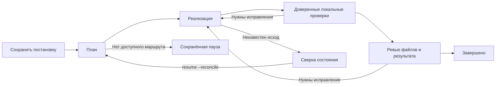

# Архитектура и принятый объём

Этот документ фиксирует рамки реализации после обсуждения 15 октября 2026 года.
Исходная [памятка v0.1](../AGENT_ORCHESTRATOR_BRIEF_RU.md) сохранена как история замысла.
При расхождениях о бесплатных моделях, бюджетах и составе ядра действуют решения ниже.

## Состав первой версии

| Компонент | Назначение |
|---|---|
| Python-контроллер | Этапы, сохранение состояния, выбор следующего маршрута, проверки |
| Claude Code | Подписочный маршрут; основной планировщик и проверяющий по умолчанию |
| Codex CLI | Подписочный маршрут; основной исполнитель и резерв руководителя |
| OpenCode | Третий адаптер ядра; прямой DeepSeek API |
| Skill Veacode | Постановка и продолжение задач из привычного ведущего агента |

Единственный платный API — DeepSeek. `policy.allow_deepseek` выключен в шаблоне.
После явного разрешения пользователя значение `true` допускает последующие обращения
без повторных вопросов и денежных потолков. `max_repairs`, таймауты и конечный список
маршрутов ограничивают работу по техническим причинам.

Бесплатные модели и акции, динамические каталоги, OpenRouter, Anthropic/OpenAI API,
самообучающийся роутер, веб-панель, параллельные исполнители и командный сервис находятся
за пределами этого среза. Три адаптера входят в ядро, а пригодность каждого маршрута
к роли руководителя должна подтверждаться практикой.

## Процесс задачи

`Controller.submit(spec, workspace)` валидирует постановку и Git-репозиторий, затем
сохраняет задачу. `Controller.run(task_id)` запускает или продолжает её.
CLI `submit` сохраняет без запуска, `run` совмещает сохранение и выполнение,
`resume` продолжает известную задачу. Это собственная точка входа; миграция произвольного
интерактивного процесса Claude Code в другой CLI не реализована.

Постановка TOML содержит `goal`, `kind`, `read_only`, `constraints`, `checks`.
Команды `checks` происходят из доверенного пользовательского файла, а не ответа модели.
Они выполняются без shell после реализации. Задача, меняющая код, требует хотя бы одной
проверки; задачи чтения могут иметь пустой список. Ревью должно вернуть JSON с boolean
`accepted` и непустым `summary`. Прохождение команд само по себе не заменяет ревью.

Маршрутизация статическая: отдельные упорядоченные списки `plan`, `execute`, `review`,
а для выполнения — необязательные списки по `kind`. Контроллер пропускает запрещённые
или уже недоступные в текущем запуске маршруты. Исправления ограничены `max_repairs`;
после неудачи реализация может перейти к следующему исполнителю.

## Состояние и восстановление

SQLite хранит задачи, этапы, попытки, PID, результаты и упорядоченные события.
Операции записи транзакционные; включены WAL и `synchronous=FULL`.
В `.veacode/tasks/TASK_ID/` сохраняются читаемые JSON-артефакты передачи,
проверок и текущей попытки. База данных — источник истины для переходов состояния.
Каталог состояния должен быть вне рабочего Git-репозитория либо под его `.veacode`;
другие внутренние каталоги отклоняются, чтобы артефакты не меняли отпечаток исходников.
Рабочий каталог нормализуется до корня Git, а блокировка относится ко всему репозиторию.

Блокировка рабочего каталога `.veacode/controller.lock` ограничивает выполнение одним
контроллером даже при разных каталогах состояния. Это блокировка ОС: наличие оставшегося
файла не означает, что процесс ещё жив. Другие редакторы и агенты эту добровольную
блокировку не обязаны соблюдать.

Перед возобновлением контроллер проверяет живые PID, активные попытки и отпечаток файлов.
Живой старый процесс блокирует новый запуск. Неизвестный исход и внешние правки требуют
явной сверки через `resume --reconcile`. После неё выполняются новое планирование и
проверки. Уже сохранённый успешный результат можно принять без повторного вызова,
если этап и отпечаток совпадают.

Git-отпечаток включает HEAD, статус, полные доступные tracked-изменения с бинарными
патчами и содержимое допустимых untracked-файлов. Данные `.veacode` исключены.
Ignored-файлы находятся вне этого контракта. Пути, похожие на секреты, в содержимое
не читаются и учитываются по метаданным. Для untracked-контента действуют пределы
1 MiB на файл и 8 MiB суммарно; пропуски отражаются в `fingerprint_complete` и `limitations`.
Поэтому отпечаток не даёт полной гарантии обнаружения всех изменений секретов,
ignored-файлов и файлов за пределами этих ограничений.

## Адаптеры и доступ

Общий контракт: `Route` + `RunRequest` → события + PID → `AdapterResult`.
Результат содержит признак успеха, финальный текст, тип ошибки, известную usage,
наблюдаемую модель и идентификатор сессии, если CLI его сообщает.
План и ревью запускаются в режиме чтения; изменение рабочего дерева на этих этапах
считается нарушением и требует сверки. Режим чтения не является общей виртуальной машиной
для произвольного кода и не заменяет ограничения самого CLI.

Адаптеры запускают дочерние процессы без shell, ограничивают вывод и время,
разбирают JSON-события и скрывают известные секреты в отчётах. На Windows для дерева
дочерних процессов используются Job Objects, на Unix — отдельная группа процессов.
Обычное прерывание очищает принадлежащее запуску дерево; после аварийного завершения
контроллер всё равно сверяет сохранённые попытки.

Claude Code и Codex используют штатные входы своих клиентов. Контроллер не извлекает
OAuth-токены и не превращает подписку в сторонний API-прокси.[^codex-auth]
OpenCode получает только прямой DeepSeek API через runtime-переменную окружения.
Текущие адаптеры ограничивают инструменты, интеграции и вложенных агентов;
существующие пользовательские конфигурации не обещаны к полному наследованию.
У OpenCode пока отклоняется проект с собственными `opencode.json`, `opencode.jsonc`
или `.opencode`, чтобы не смешивать его настройки с изолированным запуском.
У Codex отклоняются проектные `.codex/config.toml` и native `CODEX_HOME/.env`:
они могут вернуть неразрешённые интеграции или переопределить источник доступа.
Профиль `delegate`, если указан, предоставляет только уровень рассуждения;
его инструменты и остальные настройки не наследуются. Native-сессии Codex эфемерны;
идентификатор фиксируется как происхождение результата, а продолжение ведёт контроллер.

Конкретные флаги, структура событий и имена моделей зависят от версий CLI.
Программные точки входа поставщиков документированы, но это не подтверждение живой
работоспособности всех сочетаний в этом проекте.[^codex-exec][^claude-headless][^opencode-cli]
Остаток подписочной квоты считается неизвестным; usage записывается только при наличии
данных клиента. Сложный учёт стоимости и автоматический выбор моделей по цене отсутствуют.

## Приёмка пилота

Офлайн-проверки доказывают поведение контроллера на воспроизводимых ответах.
Отдельный живой пилот должен подтвердить:

1. Ограниченную задачу через Claude и Codex с обычными подписочными входами.
2. Такую же задачу через OpenCode и разрешённый DeepSeek API.
3. Продолжение при недоступном основном маршруте на старте и между этапами.
4. Сохранность частичных изменений, проверок и отчёта после перезапуска.
5. Уменьшение ручного переноса контекста без ухудшения приёмки реальных задач.

Проект не обещает бесшовную смену модели посреди произвольного вызова инструмента,
безошибочность моделей или автоматическое повторение деплоя, миграций и внешних отправок.
Реальная готовность и результаты проверок фиксируются в [STATE.md](STATE.md).

[^codex-auth]: [Codex — Authentication](https://learn.chatgpt.com/docs/auth).
[^codex-exec]: [Codex — Non-interactive mode](https://learn.chatgpt.com/docs/non-interactive-mode).
[^claude-headless]: [Claude Code — Run programmatically](https://code.claude.com/docs/en/headless).
[^opencode-cli]: [OpenCode — CLI run](https://opencode.ai/docs/cli/#run).
